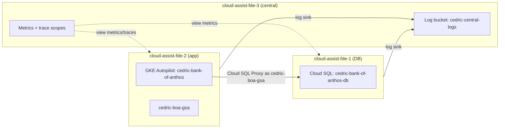

# Multi-project Bank of Anthos (GKE + Cloud SQL + central observability)

This directory contains a script that deploys Bank of Anthos across three Google Cloud projects:

| Project | Default | Contains |
|---|---|---|
| App project (`APP_PROJECT_ID`) | `cloud-assist-fde-2` | VPC, GKE Autopilot cluster, Bank of Anthos workloads, node and workload service accounts |
| DB project (`DB_PROJECT_ID`) | `cloud-assist-fde-1` | Cloud SQL for PostgreSQL instance with `accounts-db` and `ledger-db` |
| Central project (`CENTRAL_PROJECT_ID`) | `cloud-assist-fde-3` | Central log bucket, metrics scope, trace scope |



## How it works

The script uses the [Cloud SQL extra](../cloudsql/README.md)'s manifests: each backend pod runs a Cloud SQL Proxy sidecar. The proxy finds the instance by its connection name (`cloud-assist-fde-1:us-east4:cedric-bank-of-anthos-db`) and authenticates as the workload service account through Workload Identity. Because that account has `roles/cloudsql.client` in the DB project, the connection works across projects.

Logs, metrics, and traces are wired up by the [central observability extra](../central-observability/README.md), with both the app and DB projects as sources. Both are needed because Cloud SQL logs and metrics are stored in the DB project.

The script is safe to re-run. It reuses existing resources, and it reuses the database password stored in the cluster, so running pods keep working.

## Resources created

All Google Cloud resources, plus the Kubernetes namespace and service account, are named with `PREFIX` (default `cedric-`).

| Resource | Name | Project |
|---|---|---|
| VPC and subnet | `cedric-boa-vpc`, `cedric-boa-subnet` (10.10.0.0/20) | app |
| Node service account | `cedric-boa-node` (`roles/container.defaultNodeServiceAccount`) | app |
| GKE Autopilot cluster | `cedric-bank-of-anthos` | app |
| Workload service account | `cedric-boa-gsa` (`roles/cloudsql.client` in the DB project) | app |
| Kubernetes namespace and service account | `cedric-bank-of-anthos` / `cedric-boa-ksa` | app (in the cluster) |
| Cloud SQL instance | `cedric-bank-of-anthos-db` (PostgreSQL 14, Enterprise, 1 vCPU / 3.75 GB) | DB |
| Log bucket | `cedric-central-logs` | central |
| Log sinks | `cedric-boa-to-central` | app and DB |
| Trace scope | `cedric-boa-central` | central |

Names inside the cluster (Deployments, Services, ConfigMaps) and inside the database (`accounts-db`, `ledger-db`, user `admin`) are not prefixed, because the application refers to them by those names.

## Prerequisites

1. **The three projects exist**, with billing enabled.
2. **The account running the script** has, roughly:
   - App project: `roles/owner`, or Compute Network Admin, Kubernetes Engine Admin, Service Account Admin, Project IAM Admin, Service Usage Admin, and Logging and Monitoring admin roles.
   - DB project: Cloud SQL Admin, Project IAM Admin, Service Usage Admin, and Logging admin roles.
   - Central project: the roles listed in the [central observability prerequisites](../central-observability/README.md#prerequisites).
3. **Org policies** allow a Cloud SQL public IP (`constraints/sql.restrictPublicIp`) and service account creation. The proxy connects over the instance's public IP, encrypted and authorized through IAM, and no authorized networks are configured.
4. **Tools**: `gcloud` with the `beta` component, `kubectl` with `gke-gcloud-auth-plugin`, and `openssl`.

## Deploy

```
./deploy.sh
```

Override any default with an environment variable:

| Variable | Default |
|---|---|
| `APP_PROJECT_ID` | `cloud-assist-fde-2` |
| `DB_PROJECT_ID` | `cloud-assist-fde-1` |
| `CENTRAL_PROJECT_ID` | `cloud-assist-fde-3` |
| `REGION` | `us-east4` |
| `PREFIX` | `cedric-` |
| `GRANT_TELEMETRY_ROLES` | `false`. Set it to `true` to grant `cedric-boa-gsa` `roles/cloudtrace.agent` and `roles/monitoring.metricWriter`. |

The cluster and the Cloud SQL instance each take several minutes to create. When the script finishes, wait for the frontend IP:

```
kubectl get service frontend -n cedric-bank-of-anthos --watch
```

Then log in as `testuser` / `bankofanthos`. The two `populate-` Jobs should show `Completed`.

## Traces and custom metrics

By default the workload service account only has Cloud SQL access. Tracing is on in all services, so until you grant the telemetry roles they log permission errors when exporting spans and custom metrics. The app itself works normally. Logs and GKE/Cloud SQL system metrics are unaffected. To add the roles later:

```
GRANT_TELEMETRY_ROLES=true ./deploy.sh
```

## Database password

A random password is generated on the first run and stored in the `cloud-sql-admin` Secret. Bank of Anthos reads database credentials from ConfigMaps (`accounts-db-config`, `ledger-db-config`), so the script also writes the password into those when it renders the manifests. The rendered copy only exists in a temp directory during the run. Anyone who can read ConfigMaps in the namespace can see the password.

## Cleanup

```
NS=cedric-bank-of-anthos
gcloud container clusters delete cedric-bank-of-anthos --region=us-east4 --project=cloud-assist-fde-2
gcloud sql instances delete cedric-bank-of-anthos-db --project=cloud-assist-fde-1
gcloud iam service-accounts delete cedric-boa-gsa@cloud-assist-fde-2.iam.gserviceaccount.com --project=cloud-assist-fde-2
gcloud iam service-accounts delete cedric-boa-node@cloud-assist-fde-2.iam.gserviceaccount.com --project=cloud-assist-fde-2
gcloud compute networks subnets delete cedric-boa-subnet --region=us-east4 --project=cloud-assist-fde-2
gcloud compute networks delete cedric-boa-vpc --project=cloud-assist-fde-2
```

Then remove the observability resources using the [central observability cleanup](../central-observability/README.md#cleanup). Run its sink commands for both `cloud-assist-fde-2` and `cloud-assist-fde-1`, with the `cedric-` names.
